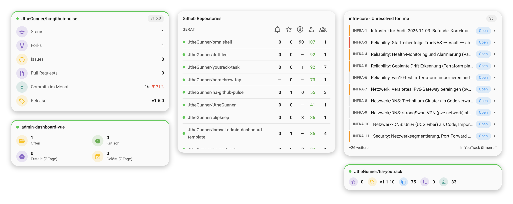
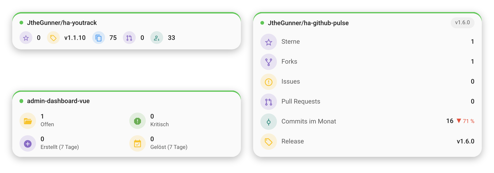
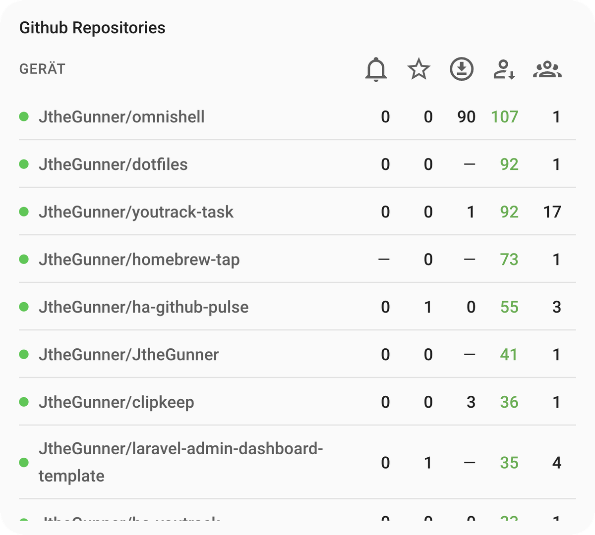
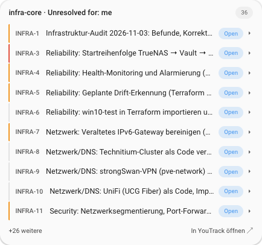

<div align="center">

# 🃏 House of Cards

**Dashboard cards for your Home Assistant integrations.**

<code>integration sensors</code> &nbsp;→&nbsp; <code>theme-aware cards</code> &nbsp;→&nbsp; <code>your dashboard</code>

[](LICENSE)
[](https://lit.dev/)
[](https://www.home-assistant.io/)
[](https://hacs.xyz/)

<br>



</div>

---

## 🎯 What it is

House of Cards is a small set of cards for the integrations you build yourself, such as [GitHub Pulse](https://github.com/JtheGunner/ha-github-pulse) and [YouTrack](https://github.com/JtheGunner/ha-youtrack). Two generic cards show **any device**, and you pick the sensors and attributes in the visual editor. Integrations bring presets with sensible defaults, so a GitHub repository or a YouTrack project looks right from the first click.

- 🛠 **Visual editor for every option**, no YAML needed
- 🎨 **Coloured icon tiles, badges and status rules** you define yourself
- 🌓 **Light and dark theme**: only Home Assistant theme variables, text sizes like Mushroom
- 🌎 **English and German**, following your Home Assistant language

---

## 📥 Installation

[](https://my.home-assistant.io/redirect/hacs_repository/?owner=JtheGunner&repository=ha-house-of-cards&category=plugin)

1. In HACS, search for **House of Cards** (category **Dashboard**) and download it.
2. Reload the browser.
3. Add a card from the card picker, or use the YAML types below.

<details>
<summary>HACS does not list it yet?</summary>

Add `https://github.com/JtheGunner/ha-house-of-cards` in HACS as a **custom repository** with the category **Dashboard**, then follow the steps above.

</details>

<details>
<summary>Manual installation</summary>

1. Download `ha-house-of-cards.js` from the [latest release](https://github.com/JtheGunner/ha-house-of-cards/releases/latest) into `config/www`.
2. Add it as a resource under _Settings_ → _Dashboards_ → _Resources_: URL `/local/ha-house-of-cards.js`, type **JavaScript Module**.

</details>

---

## 🗂 Overview

|     | Card                                                                 | Shows                                                            | Integration |
| --- | -------------------------------------------------------------------- | ---------------------------------------------------------------- | ----------- |
| 🧩  | [`hoc-device-card`](docs/cards/hoc-device-card.md)                   | One device as tiles, in the layout `compact`, `standard`, `list` | any         |
| 📋  | [`hoc-devices-card`](docs/cards/hoc-devices-card.md)                 | Several devices as a sortable table                              | any         |
| 📝  | [`hoc-youtrack-issues-card`](docs/cards/hoc-youtrack-issues-card.md) | The issues of a query sensor                                     | YouTrack    |

GitHub Pulse repositories and profiles and YouTrack projects come with ready-made defaults in the device and devices cards.

---

## 🃏 Cards

### 🧩 Device card

Any device, shown as coloured tiles in the layout you like: `compact`, `standard` or `list`. Add a badge to the title, link the name, and let rules colour the status. GitHub repositories and profiles and YouTrack projects start with ready-made fields.

<p align="center">
  
</p>

```yaml
type: custom:hoc-device-card
device: <device id>
layout: standard
```

📖 [All options](docs/cards/hoc-device-card.md)

### 📋 Devices card

Several devices as a sortable table. List every device of an integration, or pick the devices yourself. Columns take the same sensors and attributes as the device card, with colours, trend arrows and a status dot.

<p align="center">
  
</p>

```yaml
type: custom:hoc-devices-card
platform: github_pulse
sort_by: commits_this_month
sort_order: desc
```

📖 [All options](docs/cards/hoc-devices-card.md)

### 📝 YouTrack issues card

The issues of a YouTrack query sensor, with coloured states and priorities. Click an issue for its details, or `+N more` to see them all.

<p align="center">
  
</p>

```yaml
type: custom:hoc-youtrack-issues-card
entity: sensor.my_open_bugs
badge: count
```

📖 [All options](docs/cards/hoc-youtrack-issues-card.md)

> [!TIP]
> You choose which sensors and attributes the cards show with `fields` and `columns`; see [fields](docs/cards/hoc-device-card.md#fields).

> [!NOTE]
> Optional sensors are disabled by default in the integrations. A card shows a field only if its sensor is enabled.

---

## 🤝 Contributing

Issues and pull requests are welcome. To run the project locally:

```bash
npm install
npm test
npm run build   # writes dist/ha-house-of-cards.js
```

Commit the rebuilt `dist/`; CI fails if it is stale. Pull requests also get a warn-only documentation drift check that points out docs whose linked code changed. See [adding a card](docs/adding-a-card.md) for how to extend the bundle.

---

## 📝 Changelog

See [CHANGELOG.md](CHANGELOG.md).

---

## 📜 License

MIT, see [LICENSE](LICENSE).

---

<div align="center"><sub>Cards for the integrations you build yourself.</sub></div>
