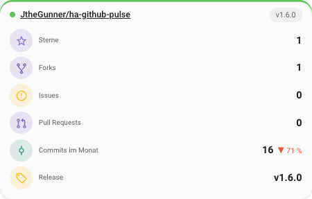
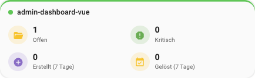

# Device card

<!-- drift: src/cards/generic/device/card.ts, src/core/fields-card.ts, src/core/fields.ts, src/core/presets.ts, src/core/status.ts -->

Any device of any integration: you choose which sensors and attributes to show. Devices of GitHub Pulse (repositories and your profile) and YouTrack (projects) start with ready-made fields and status.

| `layout: list`                                              | `layout: standard`                                                  | `layout: compact`                                                 |
| ----------------------------------------------------------- | ------------------------------------------------------------------- | ----------------------------------------------------------------- |
|  |  |  |

```yaml
type: custom:hoc-device-card
device: <device id>
layout: standard
fields:
  - battery
  - latest_release:name
  - key: temperature
    name: Room
    icon: mdi:thermometer
    color: orange
```

| Option        | Default                                              | Description                                                                                                                                                   |
| ------------- | ---------------------------------------------------- | ------------------------------------------------------------------------------------------------------------------------------------------------------------- |
| `device`      | required                                             | Any device. Pick it in the visual editor.                                                                                                                     |
| `layout`      | `standard`                                           | `compact` (icons and values in a row), `standard` (tiles) or `list` (rows)                                                                                    |
| `fields`      | the integration's preset, else the first six sensors | What to show, see below. An empty list restores the defaults.                                                                                                 |
| `show_title`  | `true`                                               | Set `false` to hide the title. A `badge` stays, and `name`, `link` and `link_url` have no effect                                                              |
| `name`        | device name                                          | Title shown in the header                                                                                                                                     |
| `link`        | none                                                 | Link the title: `device` for the device's page, or `sensor:attribute` for a URL held in an attribute (https only, opens in a new tab). `true` means `device`. |
| `link_url`    | none                                                 | Link the title to this https URL, used while `link` gives no target.                                                                                          |
| `show_status` | `true`                                               | Show the status dot and accent edge                                                                                                                           |
| `badge`       | none                                                 | A value shown as a badge on the far side of the title, see [Badge](#badge)                                                                                    |
| `status`      | the preset's status                                  | Rules that decide the status, see [Status](#status)                                                                                                           |

## Fields

Each entry is a sensor or one attribute of a sensor:

- `battery` shows the sensor `battery` of the device. The key is the sensor's translation key; sensors without one use their entity id.
- `latest_release:name` shows the attribute `name` of the sensor `latest_release`.

In the visual editor you pick from every sensor and attribute of the device. In YAML an entry can also be an object:

| Key         | Description                                                                                                                                  |
| ----------- | -------------------------------------------------------------------------------------------------------------------------------------------- |
| `key`       | Sensor key (required)                                                                                                                        |
| `attribute` | Show this attribute instead of the sensor state                                                                                              |
| `name`      | Label override                                                                                                                               |
| `icon`      | Icon override, for example `mdi:star`                                                                                                        |
| `color`     | A palette name (`blue`, `purple`, `teal`, `orange`, `pink`, `green`, `indigo`, `amber`, or any Home Assistant colour name) or any CSS colour |
| `trend`     | Key of another sensor holding a percentage, shown as an arrow                                                                                |

Name, unit and icon come from Home Assistant. Sensors that are disabled or have no value are left out.

## Badge

`badge` shows one sensor or attribute next to the title, for example the latest release of a repository:

```yaml
badge: latest_release
# or, with a colour:
badge:
  key: latest_release
  color: purple
```

The badge is grey unless you set a `color` (a palette name, a Home Assistant colour name or any CSS colour). It is left out while its sensor has no value.

## Presets

| Integration                    | Default fields                                                     | Default status                                             |
| ------------------------------ | ------------------------------------------------------------------ | ---------------------------------------------------------- |
| GitHub Pulse repository        | stars, forks, issues, pull requests, commits with trend, release   | the dot follows the CI state; failure turns the accent red |
| GitHub Pulse account (profile) | contributions with trend, current and longest streak, top language | none                                                       |
| YouTrack project               | open, overdue, critical, created and resolved in 7 days            | overdue or critical issues turn the accent red             |
| anything else                  | the first six sensors                                              | none                                                       |

## Status

Rules decide the status. It colours the accent edge and the dot in the header. Without `status` the preset's default applies. Set `show_status: false` to hide it.

The first rule that matches decides. If none matches, the status is neutral (grey dot, no accent).

```yaml
status:
  - field: issues_overdue
    operator: ">"
    value: 0
    state: failure
  - field: issues_open
    operator: ">"
    value: 20
    state: pending
  - field: issues_open
    operator: "<="
    value: 20
    state: success
```

| Key        | Description                                                                                                            |
| ---------- | ---------------------------------------------------------------------------------------------------------------------- |
| `field`    | A sensor key or `sensor:attribute`                                                                                     |
| `operator` | `=` (default), `!=`, `>`, `>=`, `<`, `<=` or `contains`. Numbers are compared as numbers, text without regard to case. |
| `value`    | What to compare with                                                                                                   |
| `state`    | `success`, `pending`, `failure`, `none`, a palette or Home Assistant colour name or any CSS colour                     |

A rule is skipped while its sensor is missing, unknown or unavailable.

## Colours

Each field gets a stable colour from the palette. Statuses override it with the theme colours: success and failure states (such as CI), overdue or critical counts, and rising or falling trends turn green or red. Colours come from theme variables, so the cards follow your theme, including UI Lovelace Minimalist.
