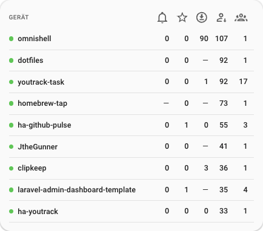

# Devices card

<!-- drift: src/cards/generic/devices/card.ts, src/core/presets.ts, src/core/status.ts, src/core/link.ts, src/core/fields.ts -->

Several devices as a sortable table. List the devices of one integration, or pick any devices. GitHub Pulse (repositories) and YouTrack (projects) come with ready-made columns and status.



```yaml
type: custom:hoc-devices-card
platform: github_pulse
columns:
  - ci_state
  - stars
  - commits_this_month
  - latest_release
sort_by: commits_this_month
sort_order: desc
```

| Option          | Default                                               | Description                                                                                                                                                   |
| --------------- | ----------------------------------------------------- | ------------------------------------------------------------------------------------------------------------------------------------------------------------- |
| `name`          | none                                                  | A title above the table. Without it the card has no header.                                                                                                   |
| `device_title`  | `Device`                                              | Title of the name column                                                                                                                                      |
| `platform`      | none                                                  | An integration, such as `github_pulse` or `youtrack`. Lists every device of it.                                                                               |
| `devices`       | none                                                  | List of devices. When set, only these are listed, of any integration.                                                                                         |
| `columns`       | the integration's preset, else the first four sensors | Sensors and attributes to show                                                                                                                                |
| `sort_by`       | `name`                                                | `name` or any column, such as `stars` or `latest_release:downloads`                                                                                           |
| `sort_order`    | `asc`                                                 | `asc` or `desc`. Missing values always sort last.                                                                                                             |
| `shorten_names` | `false`                                               | Show the part after the last `/` of a name: `repo` instead of `owner/repo`. The visual editor offers it only when a listed name contains a `/`.               |
| `column_titles` | `text`                                                | What the column titles show: `text`, `icon` or `icon_text`. Icons come from the sensor, or from `icon` in the column.                                         |
| `link`          | none                                                  | Link each name: `device` for the device's page, or `sensor:attribute` for a URL held in an attribute (https only, opens in a new tab). `true` means `device`. |
| `show_status`   | `false`                                               | A status dot before each name, see [Status](#status)                                                                                                          |
| `status`        | the preset's status                                   | Rules for the dot                                                                                                                                             |
| `max_height`    | `400`                                                 | Height in pixels before the table scrolls                                                                                                                     |

Without `devices` and `platform` the card asks you to choose one of them. With `platform` alone, devices that are an account rather than an item (the GitHub profile) are left out.

## Columns

A column is a sensor key or `sensor:attribute`, exactly like `fields` of the [device card](hoc-device-card.md#fields); objects work too: `name` replaces the column title, `icon` sets the icon used in the column title (see `column_titles`), `color` tints the values, `title_color` colours the column title, `align` sets `left`, `center` or `right` for the column, and `trend` adds a change arrow from another sensor. `sort_by` takes `name` or a column. In the visual editor you choose from every sensor and attribute of the listed devices.

Without `align`, columns that hold only numbers are right-aligned and everything else is left-aligned, titles included.

Default columns:

| Integration   | Columns                                                        |
| ------------- | -------------------------------------------------------------- |
| GitHub Pulse  | CI state, stars, commits this month with trend, latest release |
| YouTrack      | open, overdue and critical issues                              |
| anything else | the first four sensors of the first device                     |

## Status

With `show_status` every row gets a dot before its name. The first rule that matches decides; if none matches the dot is grey. Rules work like those of the [device card](hoc-device-card.md#status).

| Integration  | Default status                                      |
| ------------ | --------------------------------------------------- |
| GitHub Pulse | green when the repository had commits this month    |
| YouTrack     | red when the project has overdue or critical issues |

```yaml
show_status: true
status:
  - field: issues_overdue
    operator: ">"
    value: 0
    state: failure
```

## UI Lovelace Minimalist

Place the card in a view or a grid. It inherits the theme's colours and radius.
